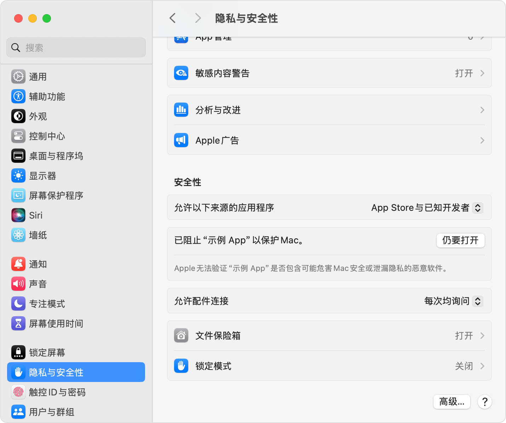

macOS通过公正和门禁系统来保护用户免受恶意软件的侵害。但是有时候需要打开仍在开发中的试验性App，需要手动允许该应用通过门禁。一般有以下几种处理方式：

1. 右键打开，手动确认
2. 被门禁阻止时，手动在设置允许打开该软件
3. 代码开启允许任意来源，关闭门禁系统
4. 删除隔离属性

## 右键打开

如果直接左键单击打开被门禁系统阻止，可以尝试使用右键呼出菜单，在菜单中选择打开。

## 系统设置内标记例外

如果开发者没有使用被Apple公证过的私钥对其开发的App进行签名，可能会被门禁系统以“尚未经过公证或由身份不明的开发者开发的App”为由阻止其运行。可以在系统设置中将最近被阻止的应用标记为例外，此后运行该软件不会再被门禁阻止。

1. 打开“系统设置”。
2. 点按“隐私与安全性”，向下滚动，然后点按“仍要打开”按钮，以确认你要打开或安装这个 App。



3. 警告提示会再次出现，如果你完全确定仍要打开这个 App，可以点按“打开”。

现在，这个 App 会作为安全性设置例外项目存储在系统中，以后你可以像使用任何经过授权的 App 一样，连按两下来打开这个 App。

## 允许任意来源的应用程序允许，关闭门禁系统

通过终端运行以下命令，以允许应用程序从各种来源运行。建议在App正常运行后重新启用此功能

```shell
sudo spctl --master-disable
```

如果要关闭任意来源可运行，执行以下步骤。

1. 打开“系统设置”。
2. 点按“隐私与安全性”，向下滚动，在选项“允许以下来源的应用程序”的下拉列表中选择仅App Store或者包括已知开发者。

## 清除程序的隔离属性

清除隔离属性

```shell
sudo xattr -rd com.apple.quarantine "<你的应用存放位置>"
```


## 参考文献

[macOS 中的门禁和运行时保护](https://support.apple.com/zh-cn/guide/security/sec5599b66df/web)

[打开来自未知开发者的 Mac App](https://support.apple.com/zh-cn/guide/mac-help/mh40616/mac)

[在 Mac 上安全地打开 App](https://support.apple.com/zh-cn/102445)