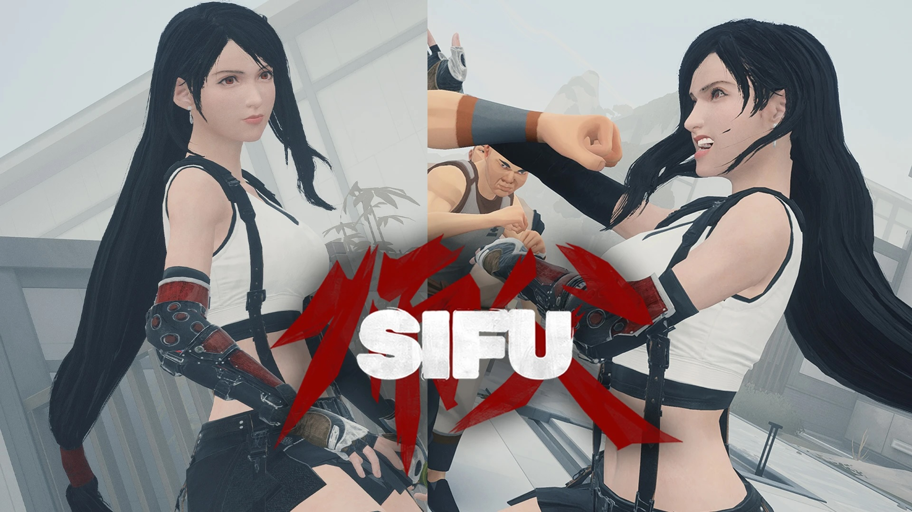

看到一个很好看的模组，是tifa的最终幻想17皮肤，制作了头发的物理效果，从视频上看手感非常好。游戏本身也是以白鹤拳为主，与蒂法使用拳术的设定相符。

下载链接：<https://www.nexusmods.com/sifu/mods/874>

安装方式：  

1. 找到装有师父软件的目录，进入其 Paks 文件夹。例如：`D:\SIFU\Sifu\Content\Paks`
2. 如果不存在这样的文件夹，请创建一个新的文件夹，命名为`~mods`。文件夹的目录应该如下：`D:\SIFU\Sifu\Content\Paks\~mods`
3. 将该模组的相关数据包和签名文件放入其中。
4. 《师傅》，启动！
