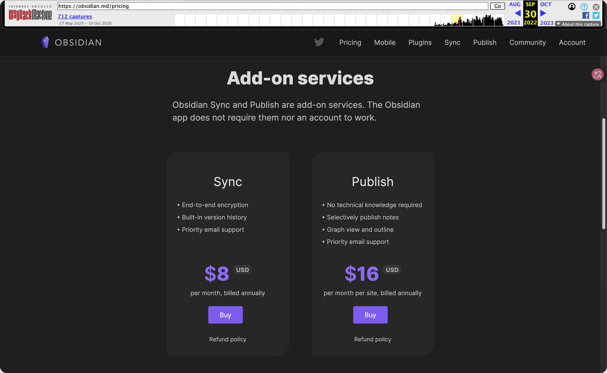
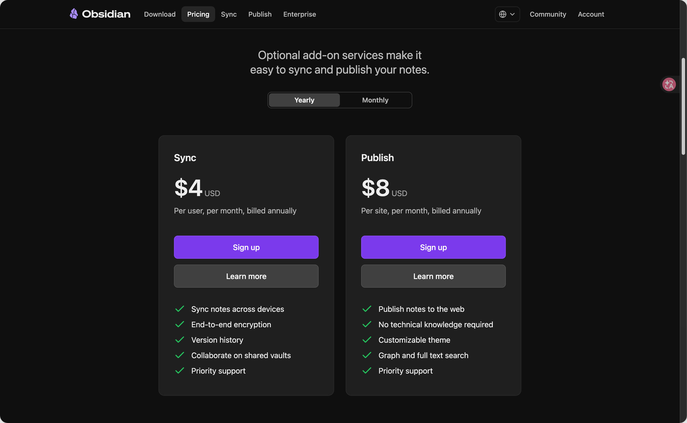
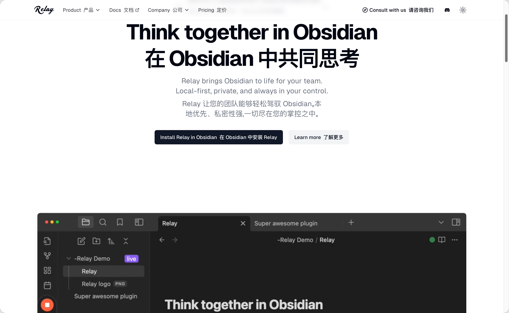
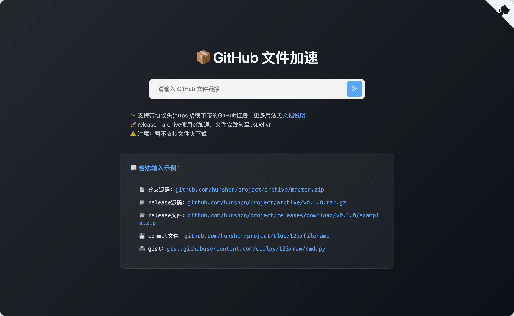

## 序言

在AI时代，使用纯文本记录的笔记软件Obsidian越来越受到大家欢迎。

相比于印象笔记、OneNote等十多年前的产物，Obsidian使用markdown格式的纯文本记录笔记，数据完全自主，没有平台私有格式锁定，你随时可以将Obsidian的笔记数据导入其他平台。

AI原生读取、输出的数据也是markdown格式。可以非常方便的读取Obsidian的数据，并将数据放回Obsidian。

但是Obsidian官方同步功能价格较贵，同步功能历史价格曾高达$8一个月。



如今价格调整后也需要$4一个月。



但是很多学生、低月薪用户付费意愿较低，一直在寻找各类能满足多设备同步需求，但价格稍低甚至免费的插件。

## 需求

使用Obsidian进行多设备协作的常见需求有如下几点：

- 实时同步，多端、多人协作。在不同的设备上编辑同一个文档，避免类似微信发送文件给对方编辑后再发回来的异步协作流程。
- 易于使用，无需过多学习成本。没有开发能力的用户占绝大多数，因此这个插件需要开箱即用，无需用户自行租赁服务器、处理项目部署。
- 异步编辑。例如在飞机、客轮离线编辑，设备断网重连后插件需要以高效的方式处理合并。
- 价格实惠。减轻对用户的经济负担。

## 解决方案：使用Relay同步笔记

因此，我要向你介绍一个新的方案，由`System3`开发的[Relay](https://relay.md/)插件，可以在不同设备之间实时同步笔记内容。



接下来会介绍如何安装并使用Relay，讲解Relay的一些缺点，以及减轻这些问题的影响。

## 使用方法

### 下载插件

如果可以直接访问Obsidian社区插件市场，那么可以直接下载并安装`relay`。

插件市场链接：<https://community.obsidian.md/plugins/system3-relay>

如果无法访问，需要在GitHub手动下载插件并放置到Obsidian插件目录。需要下载下面的3个文件。

项目源码仓库发布页：<https://github.com/No-Instructions/Relay/releases>

如果下载速度过慢，可以使用本站提供的[GitHub加速下载工具](<https://github.fp.ac.cn>)。将GitHub下载链接粘贴至文本框并下载即可。

| 文件              | GitHub下载链接                                                                        |
| --------------- | --------------------------------------------------------------------------------- |
| `main.js`       | <https://github.com/No-Instructions/Relay/releases/latest/download/main.js>       |
| `manifest.json` | <https://github.com/No-Instructions/Relay/releases/latest/download/manifest.json> |
| `styles.css`    | <https://github.com/No-Instructions/Relay/releases/latest/download/styles.css>    |



新创建一个名为`system3-relay`的文件夹，并将下载好的三个文件放入。将该文件夹放入笔记库配置文件夹下的`plugins`文件夹，例如`<vault>/.obsidian/plugins/system3-relay`。尖括号代表你需要替换为自己的笔记库。

进入Obsidian设置页面，在“第三方插件”处找到Relay并启用。

### 插件配置

选择一个账户进行登录，我使用的是Microsoft账号。 

登录成功后，需要配置Server和Vault。Relay可以和其他用户一起协作，可以一个Server并邀请团队成员加入，如果仅自己一个人使用，则创建一个人数为1的Server即可。Vault为任意一个非根目录的文件夹，我以文件夹`/repo`为例。设定完成后Relay会同步相关数据，你可以在文件夹和状态栏处看到一个卫星的图标，当卫星图标亮起时，代表你的笔记已连接服务器，正常工作中。

### 复制仓库到其他设备

**注意：本文后续还有其他建议安装的插件，建议全部安装、配置后再执行此步骤。如果仅需要安装Relay插件则可以继续执行此步骤。**

配置完成后，找到笔记库，将其整体压缩并发送到手机。在手机上解压并找个位置妥善保存。打开手机版Obsidian，选定该文件夹作为笔记库。关闭安全模式以启用插件，可能需要重新登录relay。

### 享受同步

当着一切处理完，两个设备的卫星图标均已亮起，你就可以使用relay了。你可以尝试多设备协同编辑，也可以尝试设备断网重连后如何合并离线时编辑的内容。

## 缺点：免费账户无法存储文件

Relay插件免费账户仅允许使用官方服务器同步markdown和canvas文件，其他如base、视频、音频等附件均需购买官方云存储，或则自部署。但是考虑到本期内容的受众为希望使用开箱即用插件的用户，因此自部署在本次讨论范围之外。

## 解决方案：使用Remotely Save存储数据

我推荐使用`remotely save`插件来存储静态文件。该插件支持多种标准化云存储，但是无法进行实时同步，刚好和relay优点互补。

## 使用方法

### 下载插件

如果可以直接访问Obsidian社区插件市场，那么可以直接下载并安装`remotely save`。

插件市场链接：<https://community.obsidian.md/plugins/remotely-save>

如果无法访问，需要在GitHub手动下载插件并放置到Obsidian插件目录。需要下载下面的3个文件。

项目源码仓库发布页：<https://github.com/remotely-save/remotely-save/releases>

如果下载速度过慢，可以使用本站提供的[GitHub加速下载工具](<https://github.fp.ac.cn>)。将GitHub下载链接粘贴至文本框并下载即可。

| 文件              | GitHub下载链接                                                                              |
| --------------- | --------------------------------------------------------------------------------------- |
| `main.js`       | <https://github.com/remotely-save/remotely-save/latest/download/main.js>                |
| `manifest.json` | <https://github.com/remotely-save/remotely-save/releases/latest/download/manifest.json> |
| `styles.css`    | <https://github.com/remotely-save/remotely-save/releases/latest/download/styles.css>    |


新创建一个名为`remotely-save`的文件夹，并将下载好的三个文件放入。将该文件夹放入笔记库配置文件夹下的`plugins`文件夹，例如`<vault>/.obsidian/plugins/remotely-save`。尖括号代表你需要替换为自己的笔记库。

进入Obsidian设置页面，在“第三方插件”处找到Remotely Save并启用。

### 配置Obsidian

为了更好的发挥插件的功能，推荐修改以下Obsidian设置。

1. 创建`_assets`目录用于保存附件。其中，下划线是为了让该文件夹在Obsidian文件列表中置顶。
2. 打开Obsidian设置的文件与链接标签页，选择附件默认存放位置：指定文件夹，输入刚刚新建的`_assets`，之后放在笔记的附件都会默认保存到此目录。
3. 选择删除文件设置为“将删除文件移除到Obsidian回收站（.trash文件夹）”。下次反悔时，可以在其他设备上将文件恢复。如果需要减少云存储的大小，可以将.trash文件夹删除。

### 配置插件

提到的部分建议修改，部分选项给出了说明和理由，可以参考这部分内容根据实际需求修改，其他部分保持默认即可。

#### 1. 设置一个远程服务

我在这个选项中继续使用OneDrive。OneDrive需要在云盘对应的目录创建一个同名的空白文件夹，否则会鉴权失败。例如`/Apps/remotely-save/<vault>`，尖括号代表你需要替换为自己的笔记库。

#### 2. 基本设置推荐

**自动运行：每5分钟**

**启动后自动运行一次：启动后第30秒运行一次**

#### 3. 允许同步的文件或文件夹的正则表达式

输入Obsidian回收站、Obsidian设置（默认为笔记库根目录下的.obsidian）、附件文件夹。如果你有其他想一起被同步的文件、文件夹，也可以询问AI给出对应的正则表达式。

```
.trash
.obsidian
_assets
```

#### 4. 进阶设置推荐

**同步 _ 文件或文件夹：开启**

因为使用了`_assets`文件夹保存附件。未测试实际运行是否会因正则表达式生效而忽略此选项，建议开启。

**同步配置文件夹：开启**

同步配置文件夹后，下次安装新插件后会跟随云存储自动推送到其他设备。未测试实际运行是否会因正则表达式生效而忽略此选项，建议开启。

**同步书签文件夹：开启**

**删除文件到哪里：Obsidian .trash 文件夹**

未测试实际运行是否会因正则表达式生效而忽略此选项，建议开启。

### 复制仓库到其他设备

**注意：本文推荐的插件已全部安装！如果你还有其他插件需要配置，可以配置完后再执行此步骤。**

配置完成后，找到笔记库，将其整体压缩并发送到手机。在手机上解压并找个位置妥善保存。打开手机版Obsidian，选定该文件夹作为笔记库。关闭安全模式以启用插件，可能需要重新登录云存储账号。

### 享受存储

右下角状态栏显示同步成功时，你的插件已经正常工作！你可以尝试在笔记中粘贴图片，修改书签，下载新的插件，并将修改同步到云存储中，并在其他设备查看是否正常工作。
